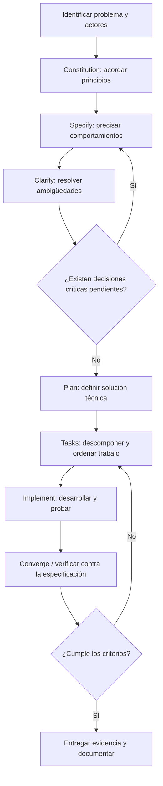

# Fundamentos de Spec-Driven Development (SDD) y su aplicación a UNL Store

| Campo | Información |
|---|---|
| Proyecto | UNL Store |
| Institución | Universidad Nacional de Loja — Carrera de Computación |
| Documento | Análisis / Fundamentos de SDD |
| Código | UNLSTORE-ANA-003 |
| Versión | 1.0 |
| Fecha | 14 de octubre de 2026 |
| Estado | Documento de estudio; no constituye aprobación de la arquitectura |
| Fase de referencia | Fase 1: backend, con proyección al frontend web y cliente móvil |

> **Propósito.** Comprender los fundamentos de desarrollo guiado por especificaciones y relacionarlos con los pasos de GitHub Spec Kit antes de diseñar e implementar UNL Store.

## 1. Contexto

UNL Store es una plataforma pública de difusión y distribución de productos tecnológicos de proyectos académicos, de investigación y de vinculación con la sociedad de la Carrera de Computación. Admitirá aplicaciones web, móviles y de escritorio; bibliotecas y componentes; modelos y soluciones de inteligencia artificial; y recursos tecnológicos adicionales.

Los acuerdos iniciales establecen: catálogo público, recursos descargables o enlaces externos y aprobación de publicaciones por un administrador. El proyecto se desarrollará en tres fases: **1) backend, 2) frontend web, 3) cliente móvil**.

En la presente etapa se estudian las necesidades del negocio, actores, reglas y preguntas abiertas. **No se presupone que las tecnologías concretas, el modelo de datos o los endpoints ya estén aprobados**.

Documentos relacionados:

- [Descripción del proyecto](../01-proyecto/descripcion-proyecto.md).
- [Identificación de actores](identificacion-actores.md).
- [Mapa de actores](mapa-actores.md).
- [Preguntas de clarificación](preguntas-clarificacion.md) — documento previsto.

## 2. ¿Qué es Spec-Driven Development?

**Spec-Driven Development (SDD)** es un enfoque de desarrollo en el que la especificación expresa la intención, los comportamientos esperados y las condiciones verificables que orientan la planificación, la implementación y su evaluación.

La especificación deja de ser una descripción informal que se archiva cuando comienza la programación: se mantiene como referencia para contrastar lo construido con lo acordado. Los agentes de IA pueden ayudar a transformar especificaciones en planes, tareas y código, pero **las decisiones y validaciones siguen requiriendo responsabilidad humana**.

### 2.1. ¿Qué significa desarrollar guiado por especificaciones?

Significa que antes de implementar se acuerdan, como mínimo:

1. El problema y los objetivos.
2. Los actores y sus necesidades.
3. Los requisitos y límites del alcance.
4. Las reglas de negocio y condiciones de excepción.
5. Los criterios de aceptación que permiten verificar el resultado.

**Ejemplo UNL Store.** Antes de programar la aprobación de productos se debe determinar quién puede enviar solicitudes, qué revisa el administrador, qué consecuencias tiene observar o rechazar, cómo se evita la autoaprobación y qué contenido puede publicarse.

## 3. Problema, requisito y solución técnica: tres conceptos distintos

| Elemento | Pregunta que responde | Ejemplo para UNL Store |
|---|---|---|
| **Problema** | ¿Qué situación debe mejorarse y por qué? | Los productos tecnológicos están dispersos y son difíciles de localizar. |
| **Requisito** | ¿Qué comportamiento o condición debe satisfacer el sistema? | El visitante deberá poder buscar productos publicados por nombre, tipo y categoría. |
| **Solución técnica** | ¿Cómo se implementará y con qué mecanismos? | Definir una API HTTP de consulta, un mecanismo de filtrado y un almacenamiento consultable; las tecnologías concretas se deciden posteriormente. |

### 3.1. Ejemplo de refinamiento

- **Necesidad:** las personas necesitan descubrir software de la carrera.
- **Requisito RF-CAT-001:** el sistema deberá ofrecer un catálogo público sin autenticación.
- **Regla RN-CAT-001:** solo deberán mostrarse productos cuya publicación esté aprobada y vigente.
- **Criterio de aceptación CA-CAT-001:** **Dado** un producto publicado y otro en revisión, **cuando** un visitante consulta el catálogo, **entonces** encuentra el publicado y no recibe el producto en revisión.
- **Diseño técnico (posterior):** definir las interfaces y los mecanismos que garanticen ese comportamiento.

La redacción del requisito es independiente de Django, Angular, Flutter, PostgreSQL o cualquier tecnología particular.

## 4. Papel de la especificación antes de implementar

Una especificación útil debe ser:

- **Comprensible:** expresa el comportamiento con lenguaje del dominio.
- **No ambigua:** deja claro quién realiza cada acción y bajo qué condiciones.
- **Verificable:** permite redactar pruebas y decidir si un resultado es correcto.
- **Consistente:** evita contradicciones entre reglas y escenarios.
- **Trazable:** relaciona necesidad, requisito, regla, criterio y prueba.
- **Acotada:** distingue funcionalidades incluidas, excluidas y aplazadas.

### 4.1. Ejemplo: solicitud de publicación

**Historia de usuario:** Como desarrollador autorizado, quiero enviar una versión a revisión para que pueda publicarse una vez aprobada.

**Reglas propuestas:**

- La versión debe pertenecer a un producto registrado.
- Debe existir, al menos, un recurso de distribución válido.
- No puede publicarse una versión no aprobada.
- La persona solicitante no puede aprobar su propia solicitud.

**Escenarios:**

1. **Éxito:** una versión completa se envía a revisión y queda pendiente de decisión administrativa.
2. **Datos incompletos:** una versión sin recursos válidos no puede enviarse a revisión.
3. **Permisos:** un usuario sin autorización no puede registrar ni aprobar publicaciones.
4. **Versión vigente:** si la versión 1.0 está publicada y la 2.0 se encuentra en revisión, la 1.0 continúa disponible.

> Estas reglas deben contrastarse con los acuerdos del equipo; los detalles aún discutibles deben registrarse mediante clarificación.

## 5. Importancia de la clarificación

La **clarificación** permite convertir afirmaciones generales en acuerdos precisos antes de comprometer el diseño técnico.

### 5.1. Fuentes de ambigüedad

- **Roles:** ¿un administrador puede ser también desarrollador?
- **Autoridad:** ¿quién aprueba una solicitud presentada por un administrador?
- **Publicación:** ¿la aprobación publica automáticamente o requiere una acción adicional?
- **Recursos:** ¿qué formatos, tamaños y comprobaciones se exigen?
- **Versiones:** ¿pueden coexistir varias versiones publicadas?
- **Licencias:** ¿cómo se verifica la autorización para redistribuir un producto?
- **Servicios externos:** ¿qué sucede si el enlace de descarga deja de funcionar?
- **IA y datos:** ¿qué declaraciones y restricciones deben acompañar modelos y conjuntos de datos?

### 5.2. Cómo registrar una clarificación

| Campo | Ejemplo |
|---|---|
| Identificador | PC-003 |
| Pregunta | ¿Quién aprueba una publicación presentada por un administrador? |
| Motivo | Evitar la autoaprobación y definir un flujo realizable |
| Alternativas | Otro administrador autorizado; proceso excepcional documentado |
| Estado | Pendiente |
| Decisión | Por registrar |
| Requisitos afectados | Autorización, revisión, auditoría |
| Evidencia | Acta o decisión aprobada |

Una respuesta no se considera acordada solo porque un asistente de IA la sugiera. Debe registrarse la decisión de la persona o equipo responsable.

## 6. Relación entre especificación, planificación y tareas

Las tres etapas responden a preguntas diferentes:

| Etapa | Pregunta | Producto esperado | Ejemplo |
|---|---|---|---|
| **Especificación** | ¿Qué y para qué se construye? | Historias, requisitos, reglas y criterios de aceptación | Los visitantes consultan exclusivamente productos publicados. |
| **Planificación** | ¿Cómo se organizará la construcción? | Decisiones de arquitectura, contratos y estrategia de pruebas | Separar catálogo y aprobación mediante responsabilidades explícitas. |
| **Tareas** | ¿Qué acciones concretas deben ejecutarse? | Lista ordenada de unidades verificables de trabajo | Crear prueba de consulta pública; implementar filtrado; verificar permisos. |

**Trazabilidad orientativa:**

`Problema → Necesidad → Requisito → Regla → Criterio de aceptación → Plan → Tarea → Prueba → Evidencia`

Si cambia una regla de negocio, deben revisarse las especificaciones y los artefactos posteriores afectados.

## 7. Flujo de GitHub Spec Kit

GitHub Spec Kit proporciona un flujo estructurado para trabajar con especificaciones y agentes de desarrollo. Para el estudio actual se consideran cinco actividades fundamentales:

| Actividad | Finalidad | Aplicación a UNL Store | Artefacto habitual |
|---|---|---|---|
| **constitution** | Establecer principios y restricciones del proyecto | Calidad, seguridad, privacidad, revisión, trazabilidad y reglas compartidas de desarrollo | `.specify/memory/constitution.md` en instalaciones habituales |
| **specify** | Describir el comportamiento requerido, sin anticipar diseño | Especificar consulta de catálogo o registro de productos | `spec.md` |
| **clarify** | Identificar y resolver vacíos de la especificación | Aclarar permisos, aprobación, versiones y distribución | Decisiones incorporadas a la especificación |
| **plan** | Definir la estrategia técnica | Arquitectura backend, contratos, persistencia, pruebas e integraciones | `plan.md` y artefactos complementarios |
| **tasks** | Convertir el plan en trabajo concreto | Dividir el desarrollo en tareas verificables | `tasks.md` |

El flujo completo también considera **implementación** y **convergencia/verificación** respecto de la especificación. La secuencia didáctica sugerida es:



### 7.1. Comandos

En muchas integraciones se presentan como:

```text
/speckit.constitution
/speckit.specify
/speckit.clarify
/speckit.plan
/speckit.tasks
```

Los nombres pueden variar según la versión y la integración del agente: algunas configuraciones utilizan comandos con guion o flujos personalizados. **Usar la forma realmente instalada en el repositorio**, sin asumir que todos los agentes exponen los mismos nombres.

No es necesario ejecutar estos comandos para completar el análisis de actores: en esta actividad se estudia y documenta el flujo.

## 8. Aplicación de SDD a las tres fases de UNL Store

### Fase 1. Backend

**Pregunta central:** ¿qué capacidades debe proporcionar el núcleo de negocio independientemente de la interfaz?

Considera identidad y permisos, proyectos, productos, categorías, versiones, archivos, enlaces externos, revisión, catálogo público, métricas y auditoría.

**Evidencia futura:** especificaciones aceptadas, contratos API, pruebas automatizadas y reglas verificadas.

### Fase 2. Frontend web

**Pregunta central:** ¿cómo podrá una persona explorar productos y cómo administrarán los responsables sus publicaciones?

Considera navegación, formularios, estados de interfaz, búsqueda, panel de desarrollador, revisión administrativa y accesibilidad. Consume las capacidades de la fase 1 sin duplicar las reglas centrales de negocio.

### Fase 3. Cliente móvil

**Pregunta central:** ¿cómo se consultarán y obtendrán productos desde un dispositivo móvil?

Considera catálogo, filtros, fichas, compatibilidad de recursos y apertura o descarga según las capacidades del dispositivo.

**Distinción importante:** admitir **aplicaciones móviles como productos** desde la fase 1 no significa que el **cliente móvil de UNL Store** se construya en esa misma fase.

## 9. Ejercicio de análisis aplicado

### Caso: registrar y publicar una biblioteca de software

**Situación:** un equipo de investigación desarrolló una biblioteca que desea ofrecer a otros desarrolladores.

**Problema:** el artefacto está en un repositorio particular y su existencia no se conoce ampliamente.

**Actores:** desarrollador, responsable del proyecto, administrador y visitante.

**Necesidad:** disponer de una ficha pública con documentación, versiones y recursos de distribución.

**Requisito:** el sistema deberá permitir registrar bibliotecas con su ecosistema tecnológico, condiciones de uso, versión, documentación y recursos.

**Pregunta de clarificación:** ¿es suficiente un enlace a un repositorio o debe publicarse también un paquete descargable?

**Criterio de aceptación:** dada una versión aprobada con enlace válido, cuando un visitante consulta la ficha, entonces puede consultar la documentación y acceder al enlace autorizado.

**Decisión técnica:** queda reservada para la planificación.

## 10. Preguntas de clarificación para UNL Store

Las siguientes preguntas deben registrarse y resolverse antes de consolidar las especificaciones afectadas:

1. ¿Quién crea o autoriza las cuentas de desarrollador?
2. ¿Un estudiante puede solicitar publicaciones por sí mismo o requiere respaldo de un docente o responsable?
3. ¿Quién evalúa una solicitud presentada por un administrador?
4. ¿Qué evidencia de licencia y titularidad debe aportarse?
5. ¿Qué extensiones, límites de tamaño y controles de seguridad se exigirán a los archivos?
6. ¿Pueden mantenerse varias versiones públicas simultáneamente?
7. ¿La aprobación implica publicación inmediata o existe una acción posterior?
8. ¿Qué procedimiento se sigue cuando un recurso externo deja de estar disponible?
9. ¿Qué información personal de desarrolladores debe mostrarse públicamente?
10. ¿Qué condiciones adicionales deben cumplir los modelos de IA y conjuntos de datos?

El documento `preguntas-clarificacion.md` desarrollará su prioridad, alternativas, decisiones y trazabilidad.

## 11. Productos de la actividad y verificación

| Evidencia solicitada | Ubicación | Condición de revisión |
|---|---|---|
| Descripción del proyecto y acuerdos | `docs/01-proyecto/descripcion-proyecto.md` | Coherencia con el alcance aprobado |
| Actores, clasificación y caracterización | `docs/02-analisis/identificacion-actores.md` | Necesidad, interacción, información y restricciones |
| Mapa de actores | `docs/02-analisis/mapa-actores.md` | Relaciones dirigidas y actores externos diferenciados |
| Fundamentos de SDD | **Este documento** | Diferencia problema/requisito/solución y relación specify-plan-tasks |
| Preguntas de clarificación | `docs/02-analisis/preguntas-clarificacion.md` | Mínimo cinco preguntas, justificadas y pendientes o resueltas |
| Fuentes y declaración de IA | Secciones 12 y 13 de este documento | Fuentes identificables y uso transparente |

### Lista de comprobación

- [ ] La explicación de SDD es coherente con el proyecto.
- [ ] Se distingue problema, requisito y solución técnica.
- [ ] Se explica por qué debe clarificarse antes de planificar.
- [ ] Se relacionan constitution, specify, clarify, plan y tasks.
- [ ] Los ejemplos se expresan con el vocabulario de UNL Store.
- [ ] Las preguntas pendientes no se presentan como decisiones aprobadas.
- [ ] Se han identificado fuentes y declarado el uso de IA.

## 12. Fuentes

### 12.1. Documentación del proyecto

1. Universidad Nacional de Loja, Carrera de Computación. *Guía didáctica: Arquitectura de un backend profesional* (material de apoyo, octubre de 2026). Archivo de consulta previsto: `references/backend/Guia_Didactica_Arquitectura_Backend_SOLID.pdf`. Temas relevantes: separación de responsabilidades, contratos, requisitos, trazabilidad, arquitectura C4 e integración de backend.

### 12.2. Documentación oficial de GitHub

2. GitHub. *Spec Kit — Documentación oficial*. https://github.github.com/spec-kit/
3. GitHub. *Spec Kit — Repositorio y comandos*. https://github.com/github/spec-kit
4. GitHub. *Spec Kit — Documentación del proceso*. https://github.com/github/spec-kit/blob/main/docs/index.md

**Nota bibliográfica:** los ejemplos de UNL Store y las preguntas específicas son elaboraciones aplicadas al caso; no deben atribuirse literalmente a las fuentes. La disponibilidad de algunos comandos depende de la versión instalada.

## 13. Declaración del uso de inteligencia artificial

En la preparación de este documento se utilizó **ChatGPT (OpenAI)** como asistencia para organizar el contenido, explicar conceptos, redactar ejemplos contextualizados en UNL Store y revisar la relación entre la documentación del proyecto y el flujo de GitHub Spec Kit.

La herramienta no sustituye la consulta de fuentes, la revisión humana ni la aprobación formal de requisitos. Las propuestas y decisiones pendientes deben validarse por el equipo responsable antes de incorporarse como requisitos definitivos.

---

## 14. Control de cambios

| Versión | Fecha | Descripción |
|---|---|---|
| 1.0 | 2026-10-14 | Documento inicial sobre fundamentos SDD, Spec Kit y aplicación a UNL Store |
