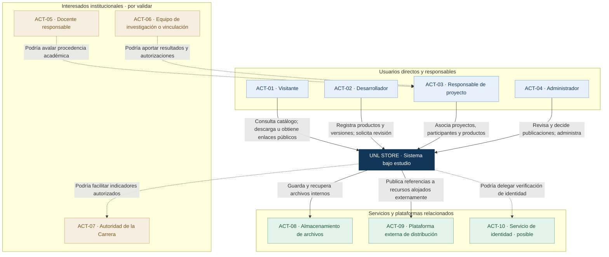
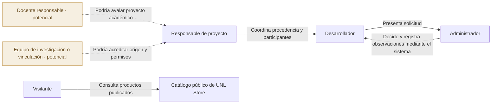

# UNL Store — Mapa de actores

> **Documento:** ANA-UNLSTORE-002  
> **Versión:** 1.0 (borrador de análisis)  
> **Fecha:** 14 de octubre de 2026  
> **Institución:** Universidad Nacional de Loja (UNL)  
> **Unidad académica:** Carrera de Computación  
> **Estado:** Pendiente de revisión y validación  
> **Fase de referencia:** Fase 1 — Backend, con proyección a frontend web y aplicación móvil

## 1. Propósito

Visualizar las relaciones entre los actores directos, los interesados institucionales, los sistemas relacionados y **UNL Store**. El mapa es una vista de **contexto funcional**: describe **quién se relaciona con el sistema, para qué y con qué condiciones**; no representa aún módulos internos, componentes tecnológicos ni una arquitectura implementada.

Este documento complementa la [descripción del proyecto](../01-proyecto/descripcion-proyecto.md) y se deriva del [inventario y caracterización de actores](identificacion-actores.md). Las preguntas pendientes se consolidarán en [preguntas de clarificación](preguntas-clarificacion.md).

## 2. Alcance confirmado

UNL Store tendrá un **catálogo público** de aplicaciones web, móviles y de escritorio, bibliotecas y componentes, modelos y soluciones de IA y otros recursos tecnológicos. Los productos proceden de proyectos **académicos, de investigación y de vinculación con la sociedad**; se distribuirán mediante **archivos descargables, enlaces externos o ambos**. Un **administrador** es responsable de aprobar las publicaciones.

El desarrollo contempla tres fases: **F1 backend**, **F2 frontend web** y **F3 cliente móvil**. El mapa representa el sistema completo y señala qué interacciones se esperan en la F1; no implica que los tres clientes existan desde el inicio.

## 3. Leyenda y criterios de lectura

| Convención | Significado |
|---|---|
| **Relación continua** | Interacción o responsabilidad confirmada por los acuerdos, o función necesaria ya identificada. |
| **Relación discontinua** | Interacción propuesta o condicionada a una decisión pendiente. |
| **Actor humano** | Persona o rol que interactúa con UNL Store. |
| **Interesado institucional** | Persona, unidad o equipo con interés en el sistema, sin suponer una cuenta o módulo propio. |
| **Sistema relacionado** | Plataforma externa o dependencia funcional; el proveedor o modalidad concreta puede quedar pendiente. |
| **Flecha etiquetada** | Se lee desde el origen hacia el destino según la acción expresada. |

**Convención de nombres:** actores en sustantivos (p. ej., «Desarrollador»); relaciones mediante verbos conjugados que describen interacciones (p. ej., «registra productos y solicita revisión»). Una flecha no concede por sí misma permisos: estos deben especificarse y aprobarse.

## 4. Mapa general de actores

> **Nota:** Mermaid se puede previsualizar en GitHub y en VS Code con una extensión compatible. El diagrama es conceptual: una función de almacenamiento necesaria no exige contratar un proveedor externo. El acceso por enlace a una plataforma de terceros tampoco presupone una integración API con esa plataforma.

## 5. Relaciones entre actores humanos

Las relaciones entre actores pueden existir **mediante UNL Store** o por procesos organizativos externos. Se presentan por separado para no confundir flujos de trabajo con intercambios automáticos entre sistemas.

La flecha «presenta solicitud» sintetiza una interacción **a través del sistema**, no una comunicación personal obligatoria. Del mismo modo, las observaciones administrativas requieren trazabilidad, pero el canal de notificación todavía no se ha decidido.

## 6. Matriz de relaciones y nivel de confirmación

| ID | Origen → destino | Relación esperada | Estado | Información implicada |
|---|---|---|---|---|
| REL-01 | Visitante → UNL Store | Consulta, busca y filtra productos públicos | Confirmada | Fichas, categorías, versiones |
| REL-02 | Visitante → UNL Store | Descarga archivos aprobados o accede a enlaces | Confirmada | Recursos autorizados, condiciones de uso |
| REL-03 | Desarrollador → UNL Store | Registra productos, versiones, documentos y recursos | Confirmada | Metadatos, archivos, enlaces, licencias |
| REL-04 | Desarrollador → UNL Store | Solicita revisión y consulta su resultado | Confirmada | Solicitud, estado, observaciones |
| REL-05 | Administrador → UNL Store | Aprueba, observa, rechaza o retira publicaciones | Confirmada | Decisiones, motivos, historial |
| REL-06 | Responsable de proyecto → UNL Store | Relaciona proyecto, participantes y productos | Definida; permisos por aclarar | Procedencia, participantes, productos |
| REL-07 | Docente → Responsable de proyecto | Aporta o valida antecedentes académicos | Propuesta | Evidencias y aval, si aplica |
| REL-08 | Equipo de investigación/vinculación → Responsable | Aporta procedencia y autorizaciones | Propuesta | Información del proyecto y derechos |
| REL-09 | UNL Store → Autoridad de la Carrera | Facilita estadísticas e informes autorizados | Propuesta | Indicadores agregados y reportes |
| REL-10 | UNL Store → Almacenamiento | Conserva y recupera archivos distribuibles | Función necesaria; proveedor por definir | Archivos, identificadores, tamaño, integridad |
| REL-11 | UNL Store → Plataforma externa | Publica un enlace hacia un recurso externo | Modalidad confirmada | URL HTTPS, tipo y destino del recurso |
| REL-12 | UNL Store → Servicio de identidad | Verifica identidad mediante proveedor externo | Condicional | Identificadores y atributos mínimos |

## 7. Límite del sistema y exclusiones

**Dentro de UNL Store (F1 backend):** autenticación y autorización de gestores; registro de proyectos, productos y versiones; administración de recursos; solicitudes y decisiones de publicación; catálogo público por API; eventos de uso y auditoría.

**Fuera de UNL Store:** ejecución de las aplicaciones publicadas, repositorios de código de terceros, instalación en dispositivos de los visitantes, servicios externos enlazados y, de adoptarse, un proveedor externo de identidad. La disponibilidad de una aplicación de un tercero no está bajo control directo de UNL Store.

**En fases posteriores:** F2 incorporará la experiencia web pública y de administración; F3 desarrollará el cliente móvil de consulta y acceso a recursos. **Una aplicación móvil publicable es un tipo de producto**, diferente del cliente móvil de UNL Store.

## 8. Casos de interacción ilustrativos

### Escenario E-01 — Descubrimiento público

1. El visitante solicita explorar productos.
2. UNL Store devuelve exclusivamente productos y versiones públicos aprobados.
3. El visitante consulta la ficha y selecciona un archivo descargable o un enlace externo.
4. UNL Store registra la interacción según su modalidad; **un clic externo no demuestra una descarga o instalación completada**.

### Escenario E-02 — Publicación administrativa

1. El desarrollador registra un producto y sus recursos de distribución.
2. El desarrollador solicita revisión.
3. El administrador examina la solicitud y registra aprobación, observaciones o rechazo.
4. UNL Store permite distribuir públicamente solo contenido aprobado.
5. Si existe una versión anterior ya publicada, esta puede continuar disponible mientras la nueva está en revisión.

### Escenario E-03 — Procedencia del producto

1. El responsable de proyecto identifica el proyecto académico, de investigación o de vinculación.
2. Se asocia el producto y su equipo con la iniciativa registrada.
3. La existencia de un aval docente o una autorización particular se valida **solo si el procedimiento institucional lo exige y se formaliza**.

## 9. Preguntas de clarificación asociadas al mapa

| Código | Pregunta | Impacto sobre el mapa |
|---|---|---|
| PC-01 | ¿Quién autoriza el alta de desarrolladores y administradores? | Permisos de ACT-02 y ACT-04 |
| PC-02 | ¿Es obligatorio un aval docente para proyectos académicos? | Mantener o retirar REL-07 |
| PC-03 | ¿Cómo se gestionará una aprobación cuando administrador y solicitante sean la misma persona? | Restricciones de REL-05 |
| PC-04 | ¿Quién verifica titularidad, licencia y autorización de distribución? | Roles de responsables y equipos |
| PC-05 | ¿El responsable de proyecto será un rol separado del desarrollador? | Permisos y representación de ACT-03 |
| PC-06 | ¿La autenticación será local o institucional/federada? | Confirmar o retirar ACT-10 y REL-12 |
| PC-07 | ¿La autoridad de la Carrera tendrá acceso directo a indicadores? | Confirmar o retirar REL-09 |
| PC-08 | ¿Cómo se comprobará la disponibilidad de recursos alojados externamente? | Precisar REL-11 sin asumir integración automática |
| PC-09 | ¿Qué información de proyectos, docentes y desarrolladores será pública? | Privacidad y exposición de datos |
| PC-10 | ¿Qué servicio conservará los archivos y qué garantías operativas tendrá? | Precisar ACT-08 y REL-10 |

Las respuestas se documentarán en [`preguntas-clarificacion.md`](preguntas-clarificacion.md) y, cuando afecten el comportamiento requerido, en [`../03-requisitos/requisitos-iniciales.md`](../03-requisitos/requisitos-iniciales.md). **No deben convertirse en requisitos aprobados solo por aparecer en el mapa.**

## 10. Criterios de revisión del mapa

- [x] El sistema bajo estudio está identificado y delimitado.
- [x] Los diez actores conservan los identificadores del inventario de actores.
- [x] Las relaciones tienen dirección y un verbo que explica la interacción.
- [x] Se distinguen relaciones confirmadas, necesarias y condicionales.
- [x] Se separan usuarios de sistemas relacionados.
- [x] Se reconoce el desarrollo en tres fases y el papel de la API del backend.
- [ ] Validar la participación de docentes, equipos y autoridad de la Carrera.
- [ ] Resolver los permisos del responsable de proyecto.
- [ ] Confirmar los proveedores y mecanismos de almacenamiento e identidad.
- [ ] Actualizar el mapa si cambian las reglas de aprobación o publicación.

## 11. Fuentes y trazabilidad

1. **UNL Store — Descripción del proyecto**, `DP-UNLSTORE-001`, v1.0: [`docs/01-proyecto/descripcion-proyecto.md`](../01-proyecto/descripcion-proyecto.md).
2. **UNL Store — Identificación y caracterización de actores**, `ANA-UNLSTORE-001`, v1.0: [`docs/02-analisis/identificacion-actores.md`](identificacion-actores.md). **Fuente principal de actores, clasificaciones y relaciones de este mapa**.
3. **Guía Didáctica: Arquitectura de un backend profesional**, compilación de octubre de 2026, material proporcionado: `references/backend/Guia_Didactica_Arquitectura_Backend_SOLID.pdf`. Especialmente la sección de modelado C4 y los principios de relaciones dirigidas y límites de sistema. Este mapa se inspira en la vista de contexto, **sin pretender ser todavía un diagrama C4 completo ni una arquitectura técnica aprobada**.

## 12. Declaración de uso de inteligencia artificial

Se utilizó **ChatGPT (OpenAI)** como apoyo para estructurar el mapa, redactar relaciones y generar diagramas Mermaid a partir de los documentos del proyecto. Las relaciones propuestas o condicionadas requieren revisión por los responsables institucionales y del proyecto. El uso de IA no sustituye la validación humana ni implica aprobación de decisiones pendientes.

---

## Control de cambios

| Versión | Fecha | Descripción | Estado |
|---|---|---|---|
| 1.0 | 2026-10-14 | Mapa de actores, relaciones, límites, escenarios y puntos de clarificación | Borrador para validación |
