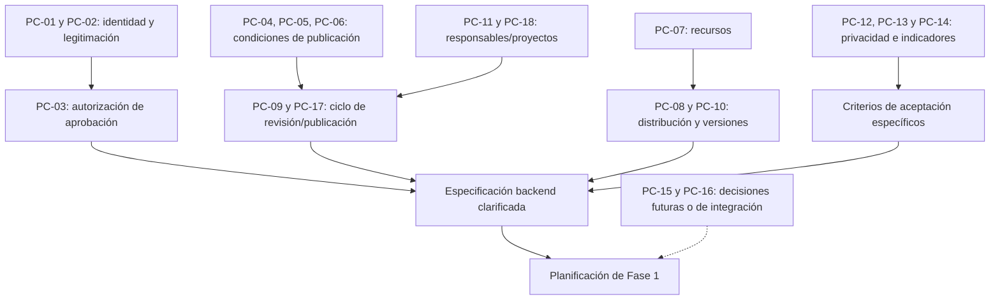

# Preguntas de clarificación — UNL Store

| Campo | Información |
|---|---|
| Proyecto | UNL Store |
| Institución | Universidad Nacional de Loja — Carrera de Computación |
| Documento | Registro de preguntas y decisiones de clarificación |
| Código | UNLSTORE-ANA-004 |
| Versión | 1.0 |
| Fecha | 14 de octubre de 2026 |
| Estado | **Abierto: preguntas pendientes de resolución** |
| Alcance | Proyecto general, con prioridad en Fase 1: backend |

> **Propósito.** Identificar ambigüedades que afecten a los requisitos de UNL Store, documentar alternativas e impactos y registrar decisiones explícitas antes de planificar o implementar las funcionalidades correspondientes. Este documento **no es una lista de decisiones ya aprobadas**.

## 1. Contexto y documentos relacionados

UNL Store permitirá registrar, revisar, publicar, descubrir y distribuir productos tecnológicos desarrollados en proyectos académicos, de investigación y de vinculación con la sociedad. Su implementación se realizará en tres fases: **backend**, **frontend web** y **cliente móvil**.

Documentos que sustentan este registro:

- [Descripción del proyecto](../01-proyecto/descripcion-proyecto.md).
- [Identificación de actores](identificacion-actores.md).
- [Mapa de actores](mapa-actores.md).
- [Fundamentos de SDD](fundamentos-sdd.md).
- [Requisitos iniciales](../03-requisitos/requisitos-iniciales.md) — cuando se consoliden.

**Convención de trazabilidad:** se utilizan referencias temáticas como `Identidad`, `Publicaciones` o `Distribución` mientras se consolida la numeración definitiva de requisitos. Las referencias `RF-*` citadas en borradores anteriores no deben considerarse una línea base aprobada.

## 2. Acuerdos confirmados: no volver a tratarlos como preguntas abiertas

| AC | Acuerdo | Implicación |
|---|---|---|
| AC-01 | El catálogo es **público**. | La exploración y consulta de productos publicados no requieren autenticación. |
| AC-02 | Los productos proceden de actividades **académicas, de investigación y de vinculación**. | Debe identificarse su procedencia. |
| AC-03 | La distribución admite **archivos internos y enlaces externos**, incluso de forma combinada. | Se requieren políticas para cada modalidad. |
| AC-04 | La aprobación de publicaciones corresponde al **administrador de UNL Store**. | Debe existir control de acceso y registro de decisiones. |
| AC-05 | Se admiten seis tipos: **web; móvil; escritorio; bibliotecas y componentes; modelos y soluciones de IA; recursos tecnológicos adicionales**. | Los metadatos y validaciones dependerán del tipo. |
| AC-06 | El proyecto se desarrolla en **F1 backend, F2 frontend web y F3 cliente móvil**. | El backend se especifica con independencia de las interfaces futuras. |
| AC-07 | Se utiliza **Spec-Driven Development (SDD)** mediante GitHub Spec Kit. | Clarificar, especificar, planificar y descomponer trabajo con trazabilidad. |

**Precisión:** el acuerdo de que aprueba un administrador **no resuelve** los procedimientos de suplencia, autoaprobación, cantidad de administradores ni las condiciones concretas para autorizar publicaciones.

## 3. Método de clarificación

Cada pregunta se registra con:

- **Código:** `PC-XX`, estable durante el proyecto.
- **Prioridad:** `P0` (bloqueante antes de especificar/planificar la funcionalidad afectada), `P1` (importante para la primera versión), `P2` (puede resolverse antes de la fase posterior afectada).
- **Estado:** `Pendiente`, `En análisis`, `Resuelta` o `Descartada`.
- **Alternativas:** opciones para discusión, **sin implicar recomendación ni aceptación automática**.
- **Impacto:** reglas, actores, permisos, datos, criterios de aceptación o interfaz afectados.
- **Decisión:** respuesta aprobada, responsable, fecha y evidencia cuando exista.

Se recomienda tratar primero las preguntas `P0`. Si una decisión provoca cambios en documentos anteriores, deben actualizarse el requisito, el mapa de actores, los escenarios y sus criterios de aceptación.

## 4. Matriz priorizada de preguntas

| Código | Prioridad | Pregunta | Ámbito / impacto | Estado |
|---|---|---|---|---|
| PC-01 | P0 | ¿Quién crea o autoriza las cuentas de desarrolladores y administradores? | Identidad y acceso | Pendiente |
| PC-02 | P0 | ¿Puede un estudiante publicar por cuenta propia o requiere aval de un docente/responsable? | Actores y procedencia | Pendiente |
| PC-03 | P0 | ¿Quién aprueba una solicitud creada por una persona que también es administrador? | Conflicto de interés | Pendiente |
| PC-04 | P0 | ¿Qué evidencia de titularidad, licencia y permiso de redistribución se exige? | Derechos de publicación | Pendiente |
| PC-05 | P0 | ¿Qué verificaciones se requieren para aprobar archivos, enlaces, modelos de IA y datasets? | Seguridad y revisión | Pendiente |
| PC-06 | P0 | ¿Qué campos comunes y específicos son obligatorios antes de solicitar aprobación? | Validación por tipo | Pendiente |
| PC-07 | P1 | ¿Qué extensiones, tamaños y número máximo de archivos se admitirán? | Almacenamiento y carga | Pendiente |
| PC-08 | P1 | ¿Puede haber varias versiones públicas y cuál se mostrará como recomendada? | Versionado y catálogo | Pendiente |
| PC-09 | P1 | ¿Aprobar una solicitud publica automáticamente el producto o hay un paso adicional? | Flujo de publicación | Pendiente |
| PC-10 | P1 | ¿Qué procedimiento se aplicará cuando un enlace externo deje de funcionar? | Distribución externa | Pendiente |
| PC-11 | P1 | ¿Quién mantiene el producto cuando sus desarrolladores dejan la carrera o el proyecto? | Responsabilidad y continuidad | Pendiente |
| PC-12 | P1 | ¿Qué información de autores y proyectos será visible al público? | Privacidad y fichas | Pendiente |
| PC-13 | P1 | ¿Cómo se medirá el uso: vistas, intentos de descarga, descargas y accesos externos? | Indicadores | Pendiente |
| PC-14 | P1 | ¿Qué condiciones adicionales se exigirán a modelos de IA y conjuntos de datos? | Riesgos, procedencia y uso | Pendiente |
| PC-15 | P2 | ¿La aplicación móvil permitirá iniciar sesión o solo consultar el catálogo público? | Fase 3 | Pendiente |
| PC-16 | P2 | ¿Se utilizará autenticación institucional o cuentas administradas por UNL Store? | Integración con identidad | Pendiente |
| PC-17 | P1 | ¿Cómo se gestionarán rechazos, observaciones, nuevas revisiones y retiros urgentes? | Ciclo de vida / auditoría | Pendiente |
| PC-18 | P1 | ¿Qué reglas permitirán asociar un producto con varios proyectos y responsables? | Modelo de procedencia | Pendiente |

> Las preguntas `PC-01` y `PC-16` son distintas: la primera trata la **autorización y administración de cuentas**; la segunda trata el **mecanismo técnico de autenticación** y su eventual integración institucional. La segunda puede avanzar durante planificación, pero sus consecuencias funcionales deben evaluarse.

## 5. Fichas de clarificación

### PC-01 — Alta de cuentas y asignación de permisos

- **Prioridad / estado:** P0 · Pendiente.
- **Pregunta:** ¿Quién crea o autoriza las cuentas de desarrolladores y administradores?
- **Situación:** el catálogo es público, pero publicar o aprobar requiere una identidad autorizada.
- **Alternativas para discusión:** alta únicamente por administrador; solicitud con validación previa; identidad institucional con habilitación de rol.
- **Impacto:** actor administrador, registro de usuarios, autorización, auditoría y casos de acceso indebido.
- **Criterio por definir:** quién puede crear, activar, desactivar y cambiar un rol.

### PC-02 — Legitimación para publicar productos académicos

- **Prioridad / estado:** P0 · Pendiente.
- **Pregunta:** ¿Los estudiantes pueden registrar y presentar publicaciones individualmente o se exige aprobación/aval de un docente o responsable del proyecto?
- **Alternativas:** publicación con cuenta autorizada; registro individual y aval previo; presentación solo por responsable del proyecto.
- **Impacto:** actores, asociación de proyecto, reglas de autorización y evidencias.
- **Criterio por definir:** evidencia exigida para cada procedencia (académica, investigación, vinculación).

### PC-03 — Conflicto de interés en la aprobación

- **Prioridad / estado:** P0 · Pendiente.
- **Pregunta:** ¿Cómo se aprueba una solicitud cuando quien la presenta también es administrador?
- **Contexto:** la regla de evitar autoaprobación fue propuesta en el análisis, pero falta definir un procedimiento viable.
- **Alternativas:** segundo administrador; suplente delegado; revisión extraordinaria documentada con rol separado.
- **Impacto:** política de permisos, decisiones administrativas, estados, auditoría y pruebas negativas.
- **Criterio por definir:** procedimiento que garantice que ninguna solicitud quede bloqueada por ausencia de un revisor habilitado.

### PC-04 — Licencia, titularidad y autorizaciones

- **Prioridad / estado:** P0 · Pendiente.
- **Pregunta:** ¿Qué declaración o evidencia debe aportarse para acreditar derechos de distribución y licencia?
- **Alternativas:** declaración responsable con licencia; registro de autorización del titular; criterios diferenciados según tipo y procedencia.
- **Impacto:** metadatos obligatorios, requisitos de publicación, responsabilidad institucional y rechazo.
- **Criterio por definir:** quién valida la evidencia y qué ocurre ante una reclamación de derechos.

### PC-05 — Controles antes de publicar recursos

- **Prioridad / estado:** P0 · Pendiente.
- **Pregunta:** ¿Qué controles mínimos de revisión se aplicarán a archivos ejecutables, librerías, enlaces, modelos y conjuntos de datos?
- **Alternativas:** validaciones automáticas de formato y tamaño más revisión administrativa; comprobaciones de integridad y análisis de archivos; protocolo específico según tipo de producto.
- **Impacto:** aceptación de recursos, revisión, integridad, tratamiento de contenido peligroso y requisitos de infraestructura.
- **Criterio por definir:** condiciones que impiden aprobación y responsables de resolver hallazgos.

### PC-06 — Metadatos obligatorios por tipo

- **Prioridad / estado:** P0 · Pendiente.
- **Pregunta:** ¿Qué información se exige al crear un borrador y cuál al solicitar revisión para cada uno de los seis tipos?
- **Alternativas:** base común más reglas por tipo; campos condicionales según distribución y plataforma.
- **Impacto:** producto, versión, validaciones, documentación y pruebas de aceptación.
- **Criterio por definir:** matriz de campos requeridos/opcionales por estado y tipo de producto.

### PC-07 — Restricciones de archivos

- **Prioridad / estado:** P1 · Pendiente.
- **Pregunta:** ¿Qué formatos, límites de tamaño y cantidad de recursos permitirá UNL Store?
- **Alternativas:** lista de formatos autorizados por tipo; límite uniforme; límites diferenciados por recurso y categoría.
- **Impacto:** carga, almacenamiento, mensajes de error, cuotas y capacidad.
- **Criterio por definir:** resultados esperados ante archivo inválido, excesivo o incompleto.

### PC-08 — Convivencia y recomendación de versiones

- **Prioridad / estado:** P1 · Pendiente.
- **Pregunta:** ¿Se permitirán varias versiones publicadas y cómo se determina la versión recomendada?
- **Alternativas:** solo la más reciente; varias disponibles y una marcada como recomendada; política específica por producto.
- **Impacto:** reglas de versiones, catálogo, continuidad y selección de descargas.
- **Criterio por definir:** comportamiento ante nueva versión pendiente, retirada o incompatible.

### PC-09 — Efecto de la aprobación

- **Prioridad / estado:** P1 · Pendiente.
- **Pregunta:** ¿La aprobación vuelve público el contenido inmediatamente o exige una acción de publicación separada?
- **Alternativas:** aprobación con publicación automática; aprobación seguida de publicación manual; publicación programada (ampliación futura).
- **Impacto:** estados de solicitud/versión/producto, auditoría y control de visibilidad.
- **Criterio por definir:** transición exacta de estados y actor que ejecuta cada transición.

### PC-10 — Enlaces externos inactivos

- **Prioridad / estado:** P1 · Pendiente.
- **Pregunta:** ¿Qué debe ocurrir si un enlace externo deja de funcionar, redirige o cambia de destino?
- **Alternativas:** aviso al responsable; marcar enlace como no disponible; suspender distribución externa hasta revisión.
- **Impacto:** fiabilidad del catálogo, validación periódica, avisos y métricas.
- **Criterio por definir:** tratamiento de enlaces rotos y plazo/responsable de corrección.

### PC-11 — Continuidad de mantenimiento

- **Prioridad / estado:** P1 · Pendiente.
- **Pregunta:** ¿Quién asume el producto cuando su responsable deja el proyecto o la carrera?
- **Alternativas:** transferir a otro desarrollador; asignar responsable institucional; retirar producto sin soporte.
- **Impacto:** titularidad operativa, cambio de responsables, continuidad y auditoría.
- **Criterio por definir:** procedimiento de transferencia y permisos.

### PC-12 — Visibilidad de información personal

- **Prioridad / estado:** P1 · Pendiente.
- **Pregunta:** ¿Qué datos de desarrolladores y proyectos pueden aparecer en fichas públicas?
- **Alternativas:** nombre público y afiliación; nombre de equipo sin datos personales; perfiles públicos opcionales.
- **Impacto:** privacidad, consentimiento/base jurídica, fichas y acceso a datos.
- **Criterio por definir:** atributos públicos, privados y administrativos.

### PC-13 — Significado de los indicadores

- **Prioridad / estado:** P1 · Pendiente.
- **Pregunta:** ¿Cómo se diferenciarán vistas, eventos de descarga, descargas completadas y clics hacia enlaces externos?
- **Alternativas:** métricas de eventos separados; agregados básicos; control opcional de duplicados o tráfico automatizado.
- **Impacto:** reglas de conteo, reportes y expectativas de autoridades/desarrolladores.
- **Criterio por definir:** qué puede afirmarse con certeza sobre cada indicador.

### PC-14 — Condiciones especiales para IA y datasets

- **Prioridad / estado:** P1 · Pendiente.
- **Pregunta:** ¿Qué declaración de procedencia, limitaciones, licencias y riesgos se exigirá a modelos de IA y conjuntos de datos?
- **Alternativas:** declaración común; fichas de modelo/datos; requisitos incrementales según riesgo o contenido.
- **Impacto:** metadatos, seguridad, privacidad, restricciones y revisión.
- **Criterio por definir:** condiciones para publicar y casos en que se prohíbe distribuir material sensible o no autorizado.

### PC-15 — Alcance del cliente móvil

- **Prioridad / estado:** P2 · Pendiente.
- **Pregunta:** ¿El cliente móvil de UNL Store permitirá únicamente explorar el catálogo o también autenticación y funciones personales?
- **Alternativas:** consulta pública; inicio de sesión para funciones particulares; ampliación futura de gestión.
- **Impacto:** requisitos y experiencia de la fase 3, sin alterar la existencia de productos móviles desde la fase 1.
- **Criterio por definir:** historias de usuario y funciones del MVP móvil.

### PC-16 — Mecanismo de autenticación

- **Prioridad / estado:** P2 · Pendiente.
- **Pregunta:** ¿La autenticación utilizará cuentas locales o identidad institucional?
- **Alternativas:** cuentas administradas en UNL Store; identidad institucional; esquema híbrido.
- **Impacto:** dependencias externas, protección de credenciales e integración.
- **Criterio por definir:** política institucional, disponibilidad del proveedor y experiencia de acceso.

### PC-17 — Revisión, corrección, rechazo y retiro

- **Prioridad / estado:** P1 · Pendiente.
- **Pregunta:** ¿Qué estados, plazos, motivos y acciones se aplicarán a observaciones, rechazos, reenvíos y retiros urgentes?
- **Alternativas:** un único ciclo de revisión; revisiones sucesivas con historial; causas tipificadas con justificación libre.
- **Impacto:** flujo de publicación, auditoría, criterios de aceptación y operación.
- **Criterio por definir:** diagrama de estados aprobado con transiciones y permisos.

### PC-18 — Vínculos entre productos y proyectos

- **Prioridad / estado:** P1 · Pendiente.
- **Pregunta:** ¿Un producto puede pertenecer a varios proyectos y quién tiene permiso para modificar esa relación?
- **Alternativas:** proyecto principal y colaboradores; múltiples proyectos sin principal; un único proyecto.
- **Impacto:** procedencia, responsabilidad, permisos y reportes.
- **Criterio por definir:** cardinalidades, reglas de edición y consistencia histórica.

## 6. Dependencias y orden de resolución



El diagrama expresa **dependencias de análisis**, no un cronograma rígido ni un diseño de componentes.

## 7. Registro de decisiones de clarificación

**No se han registrado respuestas aprobadas a las preguntas abiertas de este documento.** Cuando se resuelva una pregunta, añadir una fila:

| Pregunta | Decisión aprobada | Responsable / instancia | Fecha | Justificación o evidencia | Documentos afectados |
|---|---|---|---|---|---|
| _Pendiente_ | _Sin decisión_ | — | — | — | — |

Formato recomendado para documentar cada resolución:

```markdown
### DC-001 — [Título de la decisión]
- Pregunta relacionada: PC-XX
- Estado: Aprobada
- Decisión: [Regla explícita]
- Justificación: [Razón de negocio o restricción]
- Responsable o instancia: [Quién la valida]
- Fecha: AAAA-MM-DD
- Documentos afectados: [Rutas o identificadores]
- Criterios de aceptación nuevos o modificados: [CA-...]
```

Una decisión debe convertirse en requisito o regla concreta y verificable, no permanecer solamente como conversación o nota informal.

## 8. Relación con SDD y GitHub Spec Kit

1. **`constitution`:** recoger principios generales que afecten a todos los casos (seguridad, privacidad, autorización, trazabilidad y gobernanza).
2. **`specify`:** incorporar requisitos, escenarios y límites específicos de cada funcionalidad, identificando las ambigüedades pertinentes.
3. **`clarify`:** resolver las preguntas que sean relevantes para la especificación en curso y registrar el acuerdo en ella.
4. **`plan`:** seleccionar arquitectura y soluciones técnicas **después** de resolver las cuestiones bloqueantes de la funcionalidad.
5. **`tasks`:** descomponer lo planificado en trabajo verificable, incluyendo pruebas asociadas a requisitos y decisiones.

> Este documento es un **registro transversal de descubrimiento** dentro de `docs/`. No sustituye las aclaraciones que Spec Kit integre en el `spec.md` de cada funcionalidad ni las decisiones arquitectónicas (ADR) del posterior `plan`.

## 9. Criterios de cierre de esta actividad

- [x] Se formularon al menos cinco preguntas de clarificación (18 registradas).
- [x] Se distinguieron acuerdos existentes de preguntas abiertas.
- [x] Se consignaron prioridad, contexto, alternativas e impacto.
- [x] Se relacionaron las preguntas con el desarrollo SDD.
- [ ] Se validaron las preguntas con los interesados o responsables.
- [ ] Se registraron decisiones con responsables, fechas y evidencias.
- [ ] Se actualizaron requisitos, escenarios y documentos afectados.

**Resultado de esta versión:** preguntas identificadas y documentadas; **clarificación todavía abierta**.

## 10. Fuentes y materiales de referencia

1. Carrera de Computación, Universidad Nacional de Loja. *Descripción del proyecto UNL Store*. Documento de trabajo `docs/01-proyecto/descripcion-proyecto.md`.
2. Carrera de Computación, Universidad Nacional de Loja. *Identificación de actores*. Documento de trabajo `docs/02-analisis/identificacion-actores.md`.
3. Carrera de Computación, Universidad Nacional de Loja. *Fundamentos de SDD*. Documento de trabajo `docs/02-analisis/fundamentos-sdd.md`.
4. GitHub. *Spec Kit*, repositorio y documentación oficial: https://github.com/github/spec-kit y https://github.github.com/spec-kit/.
5. Carrera de Computación. *Guía didáctica de arquitectura de backend*. Material de consulta del proyecto, almacenado en `references/backend/`.

Las preguntas y alternativas de este documento son propuestas analíticas aplicadas a UNL Store y no transcripciones literales de estas fuentes.

## 11. Declaración de uso de inteligencia artificial

Se utilizó **ChatGPT (OpenAI)** como apoyo para organizar preguntas, proponer alternativas, redactar escenarios de ambigüedad, priorizar impactos y estructurar la trazabilidad. Las propuestas generadas no constituyen decisiones institucionales ni sustituyen la revisión humana. Los responsables del proyecto deben validar y registrar cada respuesta antes de aprobar requisitos derivados.

## 12. Control de cambios

| Versión | Fecha | Descripción |
|---|---|---|
| 1.0 | 2026-10-14 | Registro inicial de acuerdos confirmados, 18 preguntas priorizadas, fichas de análisis y mecanismo de resolución. |
